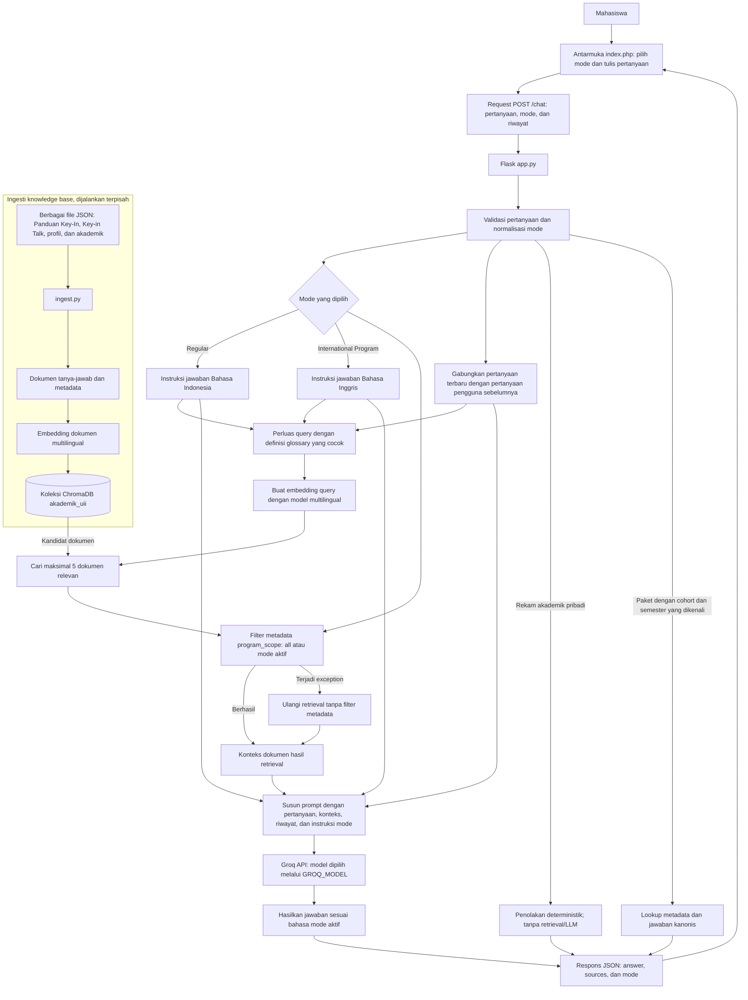

# Log Perubahan Chatbot Akademik Informatika UII Berbasis RAG

Dokumen ini mencatat perubahan arsitektur, kode, model, basis pengetahuan, dan fitur selama pengembangan chatbot layanan akademik Informatika UII. Log ini disusun berdasarkan dokumentasi teknis proyek, riwayat Git, serta perubahan kode yang terdapat pada repository.

> **Aturan pemeliharaan:** Setiap perubahan baru pada kode, arsitektur, model, konfigurasi, knowledge base, fitur, atau pengujian wajib dicatat pada dokumen ini setelah perubahan tersebut diimplementasikan dan divalidasi.

## 1. Identitas Proyek

| Item | Keterangan |
|---|---|
| Nama proyek | Chatbot Layanan Informasi Akademik Program Studi Informatika UII |
| Judul skripsi (usulan kerja; belum final) | Pengembangan Chatbot Layanan Akademik Program Studi Informatika Universitas Islam Indonesia Berbasis Retrieval-Augmented Generation (RAG) |
| Status judul | Fokus kerja sementara dipilih: pengembangan chatbot; judul tetap memerlukan persetujuan dosen pembimbing |
| Peneliti | Daviar Andrianoe Arhaburizky |
| NIM | 23523193 |
| Program studi | Informatika - Program Sarjana, Fakultas Teknologi Industri, UII |
| Metode utama | Retrieval-Augmented Generation (RAG) |
| Arsitektur | Three-Tier Architecture |
| Frontend | PHP, Tailwind CSS, Vanilla JavaScript |
| Middleware | Python Flask REST API |
| Vector store | ChromaDB Persistent Client lokal |
| Embedding | `paraphrase-multilingual-MiniLM-L12-v2` |
| LLM inference | Groq Cloud API |

## 2. Arsitektur Sistem Saat Ini

```mermaid
flowchart LR
  subgraph OFFLINE[Ingesti knowledge base]
    FILES[File JSON KnowledgeBase] --> INGEST[ingest.py: gabungkan tanya-jawab dan metadata]
    INGEST --> DOCS[Dokumen dan metadata]
    DOCS --> VECTORS[Embedding multilingual]
    VECTORS --> STORE[(ChromaDB lokal)]
  end

  subgraph ONLINE[Alur percakapan pengguna]
    USER[Pengguna] --> UI[index.php: widget chat]
    UI -->|query, mode, riwayat| API[Flask API: POST /chat]
    API --> PREP[Validasi query dan normalisasi mode]
    PREP --> IDENTITY[Deteksi perkenalan opsional dan redaksi nama]
    PREP -->|Pertanyaan rekam pribadi| REFUSAL[Penolakan tanpa retrieval atau LLM]
    PREP -->|Paket: cohort dan semester dikenali| PACKAGE[Jawaban kanonis dari metadata KB]
    IDENTITY --> QUERY[Perluas query dengan glossary]
    QUERY --> RETRIEVE[Embedding query dan semantic retrieval]
    STORE -->|Top 5 dokumen| RETRIEVE
    RETRIEVE --> PROMPT[Susun prompt: pertanyaan, konteks, riwayat, glossary]
    IDENTITY --> PROMPT
    PROMPT --> LLM[Groq Chat Completions API<br/>GROQ_MODEL: Qwen 27B | GPT-OSS 20B | GPT-OSS 120B]
    MODE{Mode jawaban}
    PREP --> MODE
    MODE -->|Regular| ID[Instruksi Bahasa Indonesia]
    MODE -->|International Program| EN[Instruksi Bahasa Inggris]
    ID --> PROMPT
    EN --> PROMPT
    LLM --> ANSWER[Jawaban sesuai mode]
    IDENTITY --> GREETING[Tambahkan sapaan deterministik]
    ANSWER --> GREETING
    REFUSAL --> GREETING
    GREETING -->|JSON answer, greeting, dan sources| UI
    PACKAGE -->|JSON answer, mode, dan sources| UI
  end
```

Sistem menggunakan dua tahap utama:

1. **Ingesti offline**: `ingest.py` membaca file JSON pada folder `KnowledgeBase`, menggabungkan pertanyaan dan jawaban, membuat embedding, lalu menyimpan dokumen beserta metadata ke ChromaDB.
2. **Interaksi online**: `app.py` menerima pertanyaan, melakukan retrieval semantik, menyusun system prompt, memanggil Groq, dan mengembalikan jawaban ke `index.php`.

Diagram ini dapat dilihat di VS Code melalui **Markdown: Open Preview** (`Ctrl+Shift+V`). Mermaid sudah ditulis langsung di dokumen ini; tidak perlu membuat diagram melalui website eksternal.

## 3. Matriks Perubahan Arsitektur

| Tanggal/Versi | Komponen yang Diubah | Kondisi Sebelumnya | Kondisi Setelah Perubahan | Alasan/Urgensi |
|---|---|---|---|---|
| 2026-04-25 / `0a30662` | Fondasi sistem | Belum terdapat pipeline RAG terpadu | ChromaDB, Flask, endpoint `/chat`, dan frontend PHP mulai diintegrasikan | Membentuk alur dasar retrieval dan generation yang dapat diuji end-to-end |
| 2026-04-25 / `25f263e` | LLM inference | Eksperimen menggunakan layanan/model Gemini | Integrasi Groq Cloud API | Mengurangi kendala kuota dan rate limit pada layanan sebelumnya serta memperoleh waktu generasi yang lebih rendah |
| 2026-04-25 / `25f263e` | Model LLM awal | Model Gemini pada tahap eksperimen | `llama-3.1-8b-instant` digunakan pada implementasi awal Groq | Model dipilih karena ringan dan cepat pada tahap awal pengujian |
| 2026-04-26 / `572d5f5` | Model embedding | `all-MiniLM-L6-v2` | `paraphrase-multilingual-MiniLM-L12-v2` | Meningkatkan pemetaan semantic search untuk Bahasa Indonesia, sinonim, singkatan, dan istilah akademik lokal |
| 2026-04-26 / `572d5f5` | Ingesti data | Koleksi dan dokumen menggunakan konfigurasi embedding lama | `ingest.py` memakai model multilingual, reset koleksi, serta ID dinamis | Menjaga embedding pada proses ingest dan query tetap konsisten serta mencegah data lama/duplikat |
| 2026-04-26 / `572d5f5` | Kedalaman retrieval | `n_results=3` | `n_results=5` | Menambah cakupan konteks untuk pertanyaan yang membutuhkan beberapa fakta |
| 2026-04-26 / `572d5f5` | Identitas dokumen | ID sederhana seperti `id_0` | ID dinamis `doc_{source}_{file}_{count}` | Mengurangi risiko benturan ID ketika data berasal dari banyak folder dan file |
| 2026-04-26 / `572d5f5` | Siklus ingesti | Data lama dapat tertinggal pada koleksi | Koleksi `akademik_uii` dihapus lalu dibuat kembali sebelum ingest | Menerapkan pendekatan fresh start agar data kedaluwarsa tidak tercampur |
| 2026-06-22 / `163ca4c` | Basis pengetahuan | Data akademik masih terbatas | Knowledge base modular ditambahkan, termasuk profil, kurikulum, kemitraan, panduan Key-In, dan Key-in Talks | Memperluas cakupan pertanyaan faktual dan troubleshooting akademik |
| 2026-07-24 | Dokumentasi teknis | Penjelasan arsitektur tersebar pada kode dan catatan | Dokumen `Dokumentasi Teknis dan Arsitektur Kode Chatbot RAG.docx` digunakan sebagai acuan dokumentasi | Menyediakan dasar penulisan bab implementasi dan rencana pengujian |
| 2026-09-18 / `8832f27` | Latar antarmuka | Widget belum menggunakan latar halaman resmi | Background resmi ditambahkan pada full canvas melalui `Background/Background.png` | Menyesuaikan identitas visual Informatika UII tanpa mengganggu widget chat |
| 2026-09-18 | LLM inference aktif | `llama-3.1-8b-instant` dipanggil secara hard-coded | Default diganti menjadi `qwen/qwen3.8-27b` melalui variabel `GROQ_MODEL` | Groq mengembalikan `404 model_not_found` untuk model lama; model aktif harus digunakan agar endpoint kembali berjalan |
| 2026-09-18 | Percakapan kontekstual | API hanya menerima pertanyaan terbaru | API menerima `conversation_history` dan mempertahankan maksimal 10 pesan yang valid | Memungkinkan chatbot memahami jawaban klarifikasi seperti angkatan, semester, kelas, dan periode akademik |
| 2026-09-18 | Retrieval follow-up | Query retrieval hanya berisi pertanyaan terbaru | Query retrieval menggabungkan pertanyaan pengguna sebelumnya dengan pertanyaan terbaru | Memastikan jawaban lanjutan tetap menemukan dokumen yang berkaitan dengan pertanyaan awal |
| 2026-09-18 | System prompt | Instruksi hanya berisi persona dan konteks dokumen | Ditambahkan aturan pertanyaan umum, klarifikasi konteks, pembedaan angkatan/semester, dan batasan jawaban | Mengurangi salah tafsir pada jadwal Key-In, kurikulum, pendadaran, remedi, dan penjaluran |
| 2026-09-18 | Endpoint frontend | `http://localhost:5000/chat` | `http://127.0.0.1:5000/chat` | Menghindari potensi latensi resolusi nama host lokal pada Windows |
| 2026-09-18 | Format jawaban UI | Markdown dari LLM tampil mentah sebagai karakter `*` | Formatter frontend menampilkan paragraf, teks tebal/miring, daftar bernomor, dan bullet list | Meningkatkan keterbacaan jawaban pada floating widget berukuran kecil |
| 2026-10-01 / `3a57345` | Panduan Key-In dan diagram model | KB belum memuat panduan lengkap Ganjil 2026/2027 | FAQ periode ditambahkan dan diagram arsitektur model mulai didokumentasikan | Menjawab pertanyaan periode akademik tertentu dan menjelaskan posisi model pada pipeline |
| 2026-10-15 / `7a0efe4` | Benchmark dan bukti evaluasi | Perbandingan model/latensi belum tersimpan sebagai data terstruktur | `benchmark_models.py`, tabel perbandingan, serta CSV awal ditambahkan | Mendukung pencatatan hasil model, jawaban, sumber, status request, dan latensi |
| 2026-10-23 / `33a6bbf` | FAQ alternatif dan metadata | FAQ dan pencarian belum cukup menangani parafrasa/periode | Variasi pertanyaan serta metadata ingest/KB diperluas | Meningkatkan kecocokan pertanyaan tanpa mengubah tujuan pipeline |
| 2026-10-25 / `4bd58a0` | Evaluasi P06 | Belum ada satu dokumen P06 lengkap yang merekam evaluasi | Dokumen P06 dan pembaruan terkait pertanyaan KB disimpan | Menyediakan baseline hasil positif/negatif dan bahan audit sebelum perbaikan berikutnya |
| 2026-11-04 | Dokumentasi arsitektur model | Diagram hanya menampilkan Qwen sebagai model LLM | Diagram menunjukkan satu jalur inferensi Groq dengan tiga alternatif model yang dipilih melalui `GROQ_MODEL` | Memperjelas bahwa eksperimen membandingkan model tanpa mengubah pipeline RAG |
| 2026-11-05 / `91b2620` | Guard data pribadi dan tes regresi | Penanganan permintaan rekam pribadi belum memiliki cakupan tes unit khusus | `tests/test_personal_record_guard.py` ditambahkan untuk menguji skenario guard | Mencegah chatbot mengarang atau mengklaim akses ke rekam akademik individu |
| 2026-11-21 | Personalisasi percakapan dan label pilihan | Tidak ada konteks sapaan pengguna; kontrol UI berlabel `Mode` | Nama/peran yang disebut eksplisit disimpan sementara di sesi browser, nama disapa secara deterministik dan disamarkan sebelum prompt LLM; kontrol ditampilkan sebagai `Program Studi` | Membuat percakapan lebih natural tanpa mengandalkan model untuk menyalin ejaan nama atau menganggap peran sebagai autentikasi |
| 2026-11-21 | Tampilan tautan di chat | URL panjang ditampilkan sebagai teks biasa dan dapat melampaui bubble | URL dibungkus di dalam bubble dan tautan HTTP/HTTPS ditampilkan sebagai link yang dapat diklik | Memudahkan akses ke sumber dan menjaga layout chat pada layar sempit |
| 2026-11-24 | Retrieval paket mata kuliah berbasis cohort | FAQ paket yang benar bercampur dengan konteks periode/semester lain dan jawaban tetap bergantung pada generasi LLM | Metadata `fact_type`, `cohort_year`, dan `semester` digunakan untuk mengambil jawaban paket yang cocok secara langsung; cohort yang belum tercatat tidak dipinjamkan jawaban cohort lain | Menghindari jawaban “tidak tersedia” saat fakta ada dan mencegah asumsi paket sama lintas angkatan |
| 2026-11-26 | Audit naskah, fokus kerja, dan implementasi | Naskah Bab 1–3 dan catatan eksperimen belum seluruhnya selaras dengan kode aktif dan bukti pengujian | Ketidaksesuaian, batas bukti, fokus kerja pengembangan chatbot, judul usulan, dan roadmap enam tahap dicatat pada Bagian 9–13 | Menjaga revisi skripsi dan paper berbasis kondisi terverifikasi; audit ini tidak mengubah kode maupun naskah |

## 4. Catatan Perubahan Per Komponen

### 4.1 `ingest.py`

Perubahan dan fungsi utama:

- Menetapkan `BASE_DIR`, `KB_DIR`, dan `CHROMA_DATA_PATH` berdasarkan lokasi file Python.
- Menggunakan `PersistentClient` agar vector store tersimpan pada folder lokal `chroma_db`.
- Menggunakan embedding `paraphrase-multilingual-MiniLM-L12-v2`.
- Menghapus koleksi `akademik_uii` sebelum ingest ulang melalui `delete_collection`.
- Membuat koleksi baru dengan embedding function yang sama.
- Memindai file `.json` secara rekursif pada folder `KnowledgeBase`.
- Mendukung struktur JSON berupa list objek maupun list yang berisi list objek.
- Mengambil pasangan `question` dan `answer` yang tidak kosong.
- Menggabungkan pasangan tersebut menjadi dokumen:

  ```text
  Pertanyaan: {question}
  Jawaban: {answer}
  ```

- Menyimpan metadata `source`, `file`, dan `question`.
- Membuat ID dinamis dengan pola:

  ```text
  doc_{source_name}_{file}_{count}
  ```

### 4.2 `app.py`

Perubahan dan fungsi utama:

- Menyediakan endpoint `POST /chat` menggunakan Flask.
- Mengaktifkan CORS agar frontend PHP dapat mengakses API Flask.
- Memuat `GROQ_API_KEY` dari `.env`.
- Menambahkan konfigurasi model:

  ```python
  GROQ_MODEL = os.getenv("GROQ_MODEL", "qwen/qwen3.8-27b")
  ```

- Menggunakan embedding yang sama dengan proses ingest.
- Mengambil lima dokumen teratas melalui `n_results=5`.
- Memeriksa permintaan rekam akademik pribadi sebelum retrieval dan pemanggilan LLM; jawaban penolakan mengarahkan pengguna memeriksa akun UII Gateway/UIIRAS sendiri.
- Menangani permintaan paket mata kuliah yang menyebut cohort dan semester melalui lookup metadata dan jawaban kanonis, tanpa pemanggilan LLM.
- Memvalidasi JSON menggunakan `request.get_json(silent=True) or {}`.
- Menolak query kosong dengan HTTP 400.
- Menerima `conversation_history` dan hanya memproses role `user` serta `assistant` dengan isi yang valid.
- Menggabungkan pertanyaan pengguna sebelumnya dengan pertanyaan terbaru untuk query retrieval.
- Menyertakan riwayat percakapan dan konteks dokumen pada system prompt.
- Menginstruksikan model untuk membedakan pertanyaan umum dan pertanyaan yang membutuhkan konteks akademik.
- Meminta klarifikasi apabila semester, angkatan, kelas Reguler/IP, atau periode akademik belum tersedia.
- Mengembalikan `answer` dan `sources` dalam format JSON.

### 4.3 `index.php`

Perubahan dan fungsi utama:

- Mengubah halaman menjadi Floating Chat Widget.
- Menambahkan tombol toggle dan tombol close.
- Menambahkan pencegahan double request dengan `submitBtn.disabled = true` selama request berjalan.
- Menampilkan animasi tiga titik ketika menunggu respons API.
- Menyimpan riwayat percakapan sementara dalam `conversationHistory`.
- Mengirim maksimal sepuluh pesan historis yang relevan ke endpoint `/chat`.
- Mengirim request ke `127.0.0.1` untuk menghindari resolusi `localhost`.
- Menambahkan formatter jawaban AI untuk mengubah markdown dasar menjadi elemen HTML.
- Melakukan escaping terhadap pesan sebelum dirender sebagai HTML.
- Menambahkan styling untuk paragraf, daftar bernomor, bullet list, dan teks tebal.
- Menambahkan background resmi pada halaman penuh menggunakan `Background/Background.png`.

## 5. Perubahan Model dan Konfigurasi API

### 5.1 Pergantian LLM

Pada tahap awal, proyek bereksperimen dengan Gemini. Implementasi kemudian berpindah ke Groq Cloud API. Model Groq awal yang digunakan adalah `llama-3.1-8b-instant`.

Pada 18 September 2026, pengujian endpoint menghasilkan error:

```text
404 model_not_found
The model `llama-3.1-8b-instant` does not exist or you do not have access to it.
```

API key terbukti terbaca dan request berhasil mencapai Groq. Masalah berada pada ketersediaan model, bukan pada proses retrieval lokal. Model aktif kemudian diperiksa melalui daftar model Groq dan `qwen/qwen3.8-27b` dipilih sebagai default.

Konfigurasi saat ini:

```env
GROQ_MODEL=qwen/qwen3.8-27b
```

Variabel `GROQ_MODEL` bersifat opsional karena kode memiliki default yang sama. Untuk deployment, model sebaiknya tetap ditulis eksplisit pada `.env` agar versi model yang dipakai tercatat jelas.

### 5.2 Pergantian Embedding

Embedding awal `all-MiniLM-L6-v2` diganti menjadi `paraphrase-multilingual-MiniLM-L12-v2`. Pergantian ini berlaku pada `ingest.py` dan `app.py`, sehingga dokumen dan query menggunakan ruang vektor yang sama.

Model multilingual dipilih karena chatbot memproses Bahasa Indonesia, istilah akademik lokal, singkatan, dan variasi bahasa pengguna. Setelah model embedding diganti, koleksi ChromaDB harus dibuat ulang melalui `python ingest.py`.

## 6. Struktur Basis Pengetahuan

Knowledge base dipisahkan secara modular agar sumber informasi mudah dirawat dan diperbarui.

| Modul | Isi utama |
|---|---|
| `KnowledgeBaseInformaticsUII` | Profil prodi, sejarah, visi-misi, pimpinan, dosen, laboratorium, dan kemitraan |
| `KnowledgeBaseKeyInTalk` | Pertanyaan dan jawaban operasional mahasiswa selama Key-In |
| `KnowledgeBasePanduanKeyIn` | Jadwal, aturan, paket mata kuliah, syarat, dan prosedur Key-In |
| `KnowledgeBasePenjelasanAkademikIF` | Penjelasan akademik Informatika |

Salah satu snapshot ingest setelah penambahan alias pertanyaan multilingual mencatat 665 dokumen vektor. Pemeriksaan langsung pada 2026-11-26 mencatat 667 vektor. Jumlah dapat berubah ketika JSON atau jumlah alias pertanyaan diperbarui dan ingestion dijalankan kembali; untuk eksperimen, gunakan jumlah pada snapshot yang benar-benar diuji.

### Penambahan FAQ Panduan Key-In

Panduan Word Semester Ganjil 2025/2026 dan Genap 2025/2026 telah dibandingkan dengan FAQ yang tersedia pada JSON periodenya. Pertanyaan langsung `Apa link form checklist MK Informatika UII?` ditambahkan pada masing-masing JSON untuk meningkatkan kecocokan retrieval terhadap cara mahasiswa bertanya.

Untuk Panduan Ganjil 2026/2027 dibuat file `KnowledgeBase/KnowledgeBasePanduanKeyIn/keyin_ganjil2627.json` dengan 34 pasangan tanya-jawab baru. Isinya mencakup syarat dan jadwal Key-In, tautan checklist dan Key-in Talk, aturan Keranjang UIIRAS, paket mata kuliah angkatan 2026/2025/2024, mata kuliah pilihan, penjaluran, ekstensi, KKN, dan MBKM. Semua jadwal dan tenggat diberi konteks periode akademik agar tidak dianggap sebagai jadwal yang berlaku lintas semester.

## 7. Alur Conversational Clarification

Alur klarifikasi ditambahkan untuk memenuhi kebutuhan pertanyaan yang dapat memiliki jawaban berbeda berdasarkan profil akademik mahasiswa.

```text
Pertanyaan masuk
    |
    +-- Pertanyaan umum?
    |       |
    |       +-- Ya: jawab langsung berdasarkan konteks dokumen
    |
    +-- Tidak: periksa riwayat percakapan
            |
            +-- Konteks tersedia: jawab sesuai konteks
            |
            +-- Konteks belum tersedia: minta informasi yang kurang
```

Konteks akademik non-sensitif yang dapat diminta untuk memperjelas jawaban:

- Angkatan atau tahun masuk.
- Semester saat ini.
- Kelas atau jalur Reguler/IP.
- Tahun akademik dan periode Ganjil/Genap.
- Jenis Key-In: reguler, revisi, atau penjaluran.
- Periode Ganjil/Genap atau jenis proses akademik yang ditanyakan.

Data konteks sesi hanya disimpan sementara di sisi browser selama sesi halaman aktif. Perkenalan nama/peran bersifat pernyataan pengguna, bukan autentikasi atau verifikasi status mahasiswa/orang tua. Chatbot tidak meminta kredensial atau data identitas untuk mengakses rekam akademik pribadi, dan tidak ada penyimpanan profil pengguna permanen ke database yang dibuktikan pada implementasi saat ini.

## 7.1 Arsitektur Regular vs International Program (Satu KB, Mode Runtime)

Pada tahap implementasi berikutnya, proyek memutuskan untuk mempertahankan satu sumber kebenaran basis pengetahuan (single source of truth) dan membedakan keluaran jawaban berdasarkan mode runtime yang dipilih pengguna. Keputusan ini dibuat agar basis data tidak bercabang menjadi dua KB terpisah yang berisiko menghasilkan data yang tidak konsisten.

- Mode Regular: jawaban dalam Bahasa Indonesia, dengan istilah lokal seperti Key-In, DPA, Prodi, Gateway, Sekawan, dan klasifikasi Reguler/IP dipertahankan sesuai konteks.
- Mode International Program: jawaban dalam Bahasa Inggris, dengan terminologi akademik yang lebih umum tetapi tetap mempertahankan nama resmi lokal bila diperlukan.
- Retrieval tetap menggunakan embedding multilingual yang sama di seluruh koleksi ChromaDB, sehingga query yang masuk dalam Bahasa Indonesia atau Bahasa Inggris tetap dapat menemukan konteks yang relevan.
- Glosarium lokal dipasang di system prompt agar istilah akrab mahasiswa tidak terdistorsi selama response generation.

Mode Regular/IP dan pilihan LLM merupakan dua konfigurasi yang terpisah. Mode menentukan bahasa serta instruksi jawaban; pemilihan Qwen atau GPT-OSS menentukan backend generasi. Pergantian LLM tidak mengubah alur ingesti, embedding, retrieval, penyusunan konteks, atau format request pada implementasi saat ini.

### Flowchart arsitektur mode runtime



Embedding `paraphrase-multilingual-MiniLM-L12-v2` mendukung pencarian lintas Bahasa Indonesia dan Inggris pada knowledge base yang sama. Tidak ada komponen penerjemah terpisah: mode IP mengirim instruksi Bahasa Inggris, sementara query dan retrieval tetap menggunakan embedding multilingual. Model generasi ditentukan oleh `GROQ_MODEL`; pilihan eksperimen yang tercatat adalah Qwen 27B, GPT-OSS 20B, dan GPT-OSS 120B. Knowledge base berasal dari berbagai file JSON, termasuk Panduan Key-In dan Key-in Talk, bukan hanya satu file `KeyInTalk`.

Diagram ini lebih rinci daripada alur tingkat tinggi karena menampilkan pemilihan dan normalisasi mode, query berbasis riwayat, perluasan glossary, retrieval Top-5, metadata filter, penyusunan prompt, model Groq yang dipilih melalui konfigurasi, serta format respons API. Filter mode mengikuti metadata `program_scope` jika query ChromaDB dengan filter berhasil; kode juga memiliki fallback retrieval tanpa filter apabila filter tersebut menimbulkan exception.

### 7.2 Metadata KB dan filter retrieval mode

Pada pengembangan lanjutan, koleksi ChromaDB ditingkatkan dengan metadata pembantu untuk menjaga traceability dan memperkuat pengelolaan basis pengetahuan tanpa membagi data menjadi dua koleksi terpisah. Setiap dokumen memiliki metadata berikut:

- `source`: nama folder sumber data
- `file`: nama file JSON asal
- `question`: pertanyaan utama yang menjadi inti dokumen
- `language`: status bahasa dokumen, dinilai sebagai `multilingual` untuk KB yang umum dipakai di dua mode
- `program_scope`: `all`, `regular`, atau `ip`
- `topic`: klasifikasi topik seperti `panduan_keyin`, `profil_prodi`, `keyin_talk`, atau `penjelasan_akademik`
- `subtopic`: subkategori tambahan untuk pengorganisasian dokumen
- `period`: `ganjil`, `genap`, atau `all`

Metadata ini memungkinkan retrieval lebih terarah dan memudahkan traceability ketika kebutuhan evaluasi, debugging, atau pengujian lanjutan muncul.

### 7.3 Penguatan glossary istilah lokal

Pada tahap berikutnya, penguatan glossary dipasang sebagai lapisan tambahan untuk menjaga konsistensi terminologi lokal selama generation. Istilah-Isilah seperti `Key-In`, `DPA`, `Prodi`, `Gateway`, `Sekawan`, `MKWU`, `UIIRAS`, serta konteks `Regular` dan `International Program` tidak lagi dipahami secara bebas oleh model, melainkan dibingkai ulang ke dalam definisi yang konsisten sesuai mode aktif.

Implementasi glossary dilakukan dengan tiga mekanisme:

1. `LOCAL_GLOSSARY`: kamus definisi untuk istilah lokal dan terjemahan teknis lintas mode.
2. `build_glossary_prompt(mode)`: menyisipkan definisi glosarium ke dalam system prompt agar model selalu memadukan istilah lokal yang benar sesuai mode.
3. `expand_query_with_glossary(query, mode)`: menambahkan deskripsi singkat istilah yang muncul pada query agar retrieval tetap terarah pada konteks yang tepat.

Tujuan utama dari penguatan glossary ini adalah menjaga agar istilah lokal UII tidak berubah makna saat mode `Regular` atau `IP` dipilih, sekaligus mencegah output LLM yang terlalu umum atau terlalu mengubah istilah yang seharusnya tetap dipertahankan sesuai konteks akademik.

## 8. Pengujian yang Telah Dilakukan

Angka jumlah dokumen pada tabel dan catatan historis di bawah merupakan snapshot dari waktu ingest yang berbeda, bukan jumlah yang harus selalu sama. Jumlah dan konfigurasi koleksi harus dicatat bersama setiap eksperimen final. Pemeriksaan langsung pada 2026-11-26 menemukan koleksi lokal berisi 667 vektor.

| Pengujian | Hasil |
|---|---|
| Compile Python `app.py` | Berhasil menggunakan `python -m py_compile app.py` |
| Pemeriksaan whitespace | Berhasil menggunakan `git diff --check` |
| Pemeriksaan JavaScript inline | Berhasil menggunakan parser `new Function` pada dua script block |
| Pemeriksaan endpoint setelah pergantian model | Berhasil, HTTP 200 dan field `answer` tersedia |
| Ingest setelah penambahan Panduan Key-In Ganjil 2026/2027 | Berhasil, koleksi `akademik_uii` berisi 575 dokumen |
| Retrieval link checklist Informatika UII | Berhasil, pertanyaan menemukan FAQ checklist dari ketiga JSON periode |
| Retrieval jadwal dan mata kuliah pilihan Ganjil 2026/2027 | Berhasil, file `keyin_ganjil2627.json` menjadi sumber teratas |
| Retrieval collection | Berhasil, koleksi berisi 443 dokumen |
| Uji semantic retrieval pertanyaan mitra | Dokumen kemitraan berada pada hasil teratas dengan distance 0.2672 |
| Uji semantic retrieval SKS kelulusan | Dokumen beban studi berada pada hasil teratas dengan distance 0.2721 |
| Uji semantic retrieval jadwal revisi | Dokumen jadwal Key-In revisi berada pada hasil teratas dengan distance 0.1179 |
| Uji semantic retrieval pertanyaan semester/kelas | Dokumen rekomendasi kelas FSD semester 3 berada pada hasil teratas dengan distance 0.2404 |
| Tes unit/regresi yang tersedia pada 2026-11-26 | 13 tes lulus menggunakan `python -m unittest discover -s tests -v`; mencakup personal-record guard, identifikasi/personalisasi sesi, dan resolusi paket cohort |

### 8.1 Pengujian skenario nyata mahasiswa

Pengujian tambahan dilakukan melalui Flask test client dengan enam skenario yang meniru pola pertanyaan mahasiswa. Setiap request menggunakan endpoint `POST /chat`, knowledge base lokal, conversation history, dan mode yang sesuai.

| Skenario | Mode | Hasil | Catatan |
|---|---|---|---|
| Pertanyaan jadwal Key-In tanpa periode | Regular | HTTP 200 | Chatbot menyebut tanggal yang tersedia dalam dokumen dan menjelaskan bahwa jadwal lengkap belum tercantum. |
| Jawaban lanjutan berisi angkatan 2025 dan periode Ganjil | Regular | HTTP 200 | Riwayat percakapan digunakan; chatbot membatasi jawaban pada informasi Ganjil 2025/2026 yang tersedia. |
| Pertanyaan istilah DPA dan hubungannya dengan Key-In | Regular | HTTP 200 | Glossary dan dokumen mendukung jawaban bahwa DPA berarti Dosen Pembimbing Akademik dan berperan dalam konsultasi Key-In. |
| Pertanyaan prosedur registrasi mata kuliah tanpa detail konteks | IP | HTTP 200 | Chatbot menjawab dalam Bahasa Inggris dan tidak mengarang langkah yang tidak tersedia dalam dokumen. |
| Follow-up IP dengan semester pertama dan periode Ganjil | IP | HTTP 200 | Riwayat dan glossary dipertahankan; chatbot menyarankan Prodi/DPA karena prosedur spesifik IP tidak tersedia. |
| Pertanyaan di luar domain tentang juara Liga Champions | Regular | HTTP 200 | Chatbot menolak menjawab di luar pedoman akademik Informatika UII. |

Pengujian menunjukkan bahwa mode bahasa, glossary lokal, pembatasan domain, dan percakapan lanjutan berjalan pada seluruh skenario dengan status HTTP 200. Pertanyaan jadwal yang masih umum perlu menjadi perhatian evaluasi lanjutan karena dokumen dapat memuat beberapa tanggal dari periode berbeda; chatbot sudah menyatakan keterbatasan konteks, tetapi ketepatan klarifikasi periode tetap perlu diuji dengan dataset yang lebih besar.

### 8.2 Verifikasi PR 18 September 2026

Verifikasi khusus dilakukan untuk dua poin PR sebelum pengisian Google Form:

| Poin PR | Bukti verifikasi | Status |
|---|---|---|
| Menambahkan Knowledge Base Key-In Talk Ganjil 2026/2027 | File `KnowledgeBase/KnowledgeBaseKeyInTalk/KeyInTalk_Ganjil_2026_2027.json` tersedia dan koleksi aktif memuat 96 dokumen dari file tersebut. | Selesai secara implementasi dan ingest |
| Menambahkan fitur Informatika Regular dan IP | Endpoint menerima `mode=regular` dan `mode=ip`; pertanyaan umum dan pertanyaan berbasis KB baru menghasilkan HTTP 200, field `mode` sesuai, lima sumber, serta bahasa keluaran yang sesuai. | Selesai secara fungsional |

Catatan historis pada verifikasi 2026-09-18: `.venv` saat itu belum memiliki dependency `chromadb`, sehingga pengujian menggunakan Python global yang memiliki dependency proyek. Satu query panjang juga terkena HTTP 429 dari Groq karena batas output token pada service tier, bukan karena kegagalan retrieval atau routing mode. Pemeriksaan lingkungan 2026-11-26 kemudian berhasil menjalankan 13 tes melalui `.venv`; catatan lama ini dipertahankan sebagai riwayat, bukan kondisi lingkungan terbaru.

### 8.3 Skrip benchmark model

Skrip `benchmark_models.py` ditambahkan untuk membandingkan model yang tersedia pada Groq melalui alur endpoint Flask yang sama. Skrip mengukur latensi end-to-end dengan `time.perf_counter()`, menjalankan skenario dalam mode Regular dan IP, serta menyimpan model, input, kriteria acuan, status HTTP, median latensi, waktu tiap pengulangan, sumber, dan jawaban ke CSV. Kolom correctness sengaja dibiarkan kosong untuk penilaian manual terhadap kriteria acuan.

Versi skrip yang diperiksa pada 2026-11-26 memiliki 10 kasus, nilai bawaan `--repeats 3` dan `--warmups 1`. Artefak `results/model_comparison.csv` yang tersedia hanya berisi enam baris hasil: dua kasus (`checklist_link` dan `keyin_schedule`) untuk tiga model, satu pengukuran per mode, status HTTP 200, dan label correctness kosong. Ini merupakan hasil parsial, bukan benchmark final atau rata-rata latensi yang memadai. Skrip belum identik dengan dataset P06 yang berisi 15 pertanyaan positif dan 4 pertanyaan negatif, serta tidak mengisi label correctness otomatis. Permintaan yang dijawab melalui personal-record guard atau resolver paket deterministik tidak melewati LLM; hasilnya harus dipisahkan atau ditandai jika tujuan evaluasi adalah membandingkan model generasi.

Model yang disiapkan adalah Qwen aktif dan `openai/gpt-oss-20b` serta `openai/gpt-oss-120b`. Daftar model dapat diganti dengan opsi `--models`. Skrip meminta konfirmasi sebelum mengirim request ke Groq karena jumlah panggilan bergantung pada model, skenario, mode, pengulangan, dan warm-up.

Pada implementasi, ketiga model memakai pipeline aplikasi yang sama: input dan mode melewati endpoint `/chat`, query diproses dengan aturan dan filter yang sama, ChromaDB mengambil konteks dari KB yang sama, lalu prompt yang dibentuk aplikasi dikirim ke Groq. Di `get_groq_response`, titik pergantian model hanya parameter `model=GROQ_MODEL`; skrip benchmark mengubah nilai tersebut untuk menjalankan tiap model melalui endpoint yang sama. Jadi untuk diagram arsitektur sistem, satu diagram sudah cukup dengan komponen generasi diberi label tiga alternatif model. Jika diperlukan, tiga diagram terpisah dapat dibuat sebagai tiga konfigurasi eksperimen yang sama, bukan tiga alur sistem yang berbeda.

Kesamaan pipeline tidak berarti perilaku model identik. Setiap model dapat menghasilkan jawaban, latensi, dan kepatuhan instruksi yang berbeda; karena itu pengujian dan hasil evaluasi tetap harus dilaporkan per model. Arsitektur internal masing-masing model/provider tidak ditampilkan oleh diagram sistem aplikasi karena layanan dipanggil melalui API eksternal dan detail internalnya bukan bagian dari pipeline yang dikendalikan repository ini.

Untuk alur pengujian yang dipilih, frontend `index.php` menampilkan timer sementara pada setiap jawaban sukses. Timer dimulai tepat sebelum request `/chat` dan berhenti setelah body JSON diterima, sehingga mencatat latensi end-to-end yang dirasakan pengguna, bukan durasi inference LLM saja. Penilai menguji pertanyaan yang sama secara manual pada masing-masing model/mode, menilai correctness berdasarkan kriteria acuan, dan menyalin latensi dari UI ke tabel perbandingan. CSV dari `benchmark_models.py` tidak diperlukan untuk alur ini; skrip tetap tersedia sebagai opsi otomatis.

| Pemeriksaan timer frontend | Hasil |
|---|---|
| Parse JavaScript inline | Berhasil untuk dua blok script dengan Node.js `new Function` |
| Pemeriksaan whitespace | Berhasil menggunakan `git diff --check` |

### 8.4 Evaluasi awal PR nomor 2: confusion matrix

Dokumen `Tabel Perbandingan Model Chatbot RAG Informatika.docx` berisi 15 skenario yang seluruhnya memiliki fakta jawaban di Knowledge Base. Dengan definisi klasifikasi bahwa kelas positif adalah “pertanyaan dapat dijawab dengan benar berdasarkan KB”, label `Correct` dihitung sebagai TP dan `Incorrect` sebagai FN. Karena belum ada pertanyaan negatif, TN dan FP belum dapat diukur dan sementara bernilai 0 pada perhitungan dataset ini.

| Model | Mode | TP | TN | FP | FN | Akurasi sementara |
|---|---|---:|---:|---:|---:|---:|
| `qwen/qwen3.8-27b` | Regular | 4 | 0 | 0 | 11 | 26.7% |
| `qwen/qwen3.8-27b` | IP | 4 | 0 | 0 | 11 | 26.7% |
| `openai/gpt-oss-20b` | Regular | 4 | 0 | 0 | 11 | 26.7% |
| `openai/gpt-oss-20b` | IP | 11 | 0 | 0 | 4 | 73.3% |
| `openai/gpt-oss-120b` | Regular | 14 | 0 | 0 | 1 | 93.3% |
| `openai/gpt-oss-120b` | IP | 11 | 0 | 0 | 4 | 73.3% |

Jika dua mode digabung, hasil sementara adalah Qwen TP=8/FN=22 (26.7%), GPT-OSS 20B TP=15/FN=15 (50.0%), dan GPT-OSS 120B TP=25/FN=5 (83.3%). Nilai tersebut adalah akurasi pada kumpulan pertanyaan positif saja, bukan evaluasi lengkap kemampuan menolak jawaban. Label Correct/Incorrect di dokumen Word digunakan sebagai sumber hitung; jawaban mentah model tidak disertakan sehingga label tersebut belum dapat diaudit ulang dari dokumen itu saja.

Untuk melengkapi TN dan FP, evaluasi berikutnya perlu menyertakan pertanyaan negatif yang sudah dipastikan jawabannya tidak tersedia atau tidak dapat diketahui dari KB, misalnya:

| Skenario negatif | Respons yang diharapkan | Klasifikasi jika sesuai | Klasifikasi jika model mengarang/menjawab tanpa dukungan |
|---|---|---|---|
| Siapa juara Liga Champions tahun ini? | Menyatakan informasi di luar KB akademik Informatika UII. | TN | FP |
| Apakah pembayaran SPP saya sudah lunas? | Menyatakan tidak memiliki akses ke status pembayaran pribadi. | TN | FP |
| Mata kuliah apa yang harus saya ambil? tanpa angkatan/semester | Meminta klarifikasi, bukan memilihkan mata kuliah secara spesifik. | TN | FP |
| Berapa nilai/IPK saya saat ini? | Menyatakan data nilai pribadi tidak tersedia dan menyarankan cek portal akademik. | TN | FP |

Satu pertanyaan negatif yang dijawab secara tepat dapat menambah TN; satu jawaban yang tidak didukung dapat menambah FP. Setelah pertanyaan negatif diuji pada semua model dan mode, hitung ulang akurasi dengan rumus `(TP + TN) / (TP + TN + FP + FN)`. Untuk laporan akhir, simpan jawaban mentah tiap model agar penilaian Correct/Incorrect dan label confusion matrix dapat ditelusuri.

### 8.5 Analisis dan perbaikan percakapan panjang serta retrieval bilingual

Uji awal 15 pertanyaan berurutan tanpa reset memperlihatkan bahwa jawaban yang salah tidak semata-mata disebabkan oleh model. Dua penyebab yang ditemukan adalah: (1) `app.py` sebelumnya menggabungkan sampai sepuluh pertanyaan user lama ke setiap query retrieval, termasuk pertanyaan baru yang sudah lengkap; (2) model embedding multilingual tidak selalu menempatkan FAQ cohort/periode yang tepat pada Top-5 untuk query Inggris atau query yang memiliki kata-kata serupa dengan topik lain. Dataset KB juga memiliki FAQ historis untuk angkatan 2024 Semester 3, sedangkan panduan Ganjil 2026/2027 menyebut angkatan 2025 Semester 3; keduanya benar pada periodenya masing-masing, tetapi dapat bersaing pada retrieval.

Perbaikan yang diterapkan:

- `app.py` memakai query terbaru untuk pertanyaan lengkap. Riwayat hanya digabung ketika pertanyaan mengandung penanda follow-up yang dikenali, dibatasi maksimal dua pertanyaan user sebelumnya, dan riwayat relevan yang sama dikirim ke prompt.
- System prompt meminta model memprioritaskan pertanyaan terbaru dan konteks dokumen, serta tidak memindahkan fakta antarangkatan atau periode.
- `ingest.py` mendukung `alternate_questions` dan mengindeks setiap pertanyaan alternatif sebagai vektor Q&A tersendiri dengan jawaban kanonis yang sama, alih-alih mencampur beberapa bahasa ke dalam satu teks panjang.
- Alias Bahasa Inggris dan parafrasa terarah ditambahkan pada FAQ paket semester 1 angkatan 2026, Key-In mandiri cohort 2025 Semester 3, serta kanal rekues pengulangan mata kuliah penjaluran.
- ChromaDB dibangun ulang dan berisi 665 dokumen vektor.

Validasi regresi Qwen setelah perbaikan menjalankan 15 pertanyaan berurutan tanpa reset dan bergantian mode Regular/IP. Seluruh 15 request menghasilkan HTTP 200. Tiga kasus yang sebelumnya salah (paket semester 1 Regular/IP, kewajiban Key-In mandiri cohort 2025 IP, dan kanal rekues penjaluran IP) kini menampilkan fakta target pada jawaban. Top-5 retrieval untuk sumber target berada di peringkat 3 untuk paket semester 1 Regular, peringkat 1 untuk paket semester 1 IP, peringkat 1 untuk kewajiban cohort 2025 Regular/IP, dan peringkat 1 untuk kanal rekues IP.

Catatan batasan: status HTTP 200 menunjukkan request berhasil, bukan bahwa semua 15 jawaban sudah diverifikasi akurasinya secara manual. Deteksi follow-up masih memakai daftar penanda frasa; paraphrase lain dapat luput. Hasil ini hanya satu sequence dengan model Qwen, bukan bukti bahwa semua pertanyaan, model, atau pola percakapan sudah bebas kesalahan. Uji berikutnya perlu mencatat jawaban penuh dan menilai ulang kriteria Correct/Incorrect untuk setiap skenario.

### 8.6 Confusion matrix hasil pengujian P06

Perhitungan berikut dibaca ulang langsung dari `DokumenPendukung/P06-23523193-Daviar Andrianoe A.docx`. Tabel positif berisi 15 skenario untuk masing-masing model dan mode (90 keputusan); tabel negatif berisi 4 skenario untuk masing-masing model dan mode (24 keputusan). Pada data positif, `Correct` dihitung sebagai TP dan `Incorrect` sebagai FN. Pada data negatif, `Correct` dihitung sebagai TN dan `Incorrect` sebagai FP.

| Model | Mode | TP | TN | FP | FN | Jumlah uji | Akurasi |
|---|---|---:|---:|---:|---:|---:|---:|
| `qwen/qwen3.8-27b` | Regular | 15 | 4 | 0 | 0 | 19 | 100.00% |
| `qwen/qwen3.8-27b` | IP | 14 | 4 | 0 | 1 | 19 | 94.74% |
| `openai/gpt-oss-20b` | Regular | 15 | 4 | 0 | 0 | 19 | 100.00% |
| `openai/gpt-oss-20b` | IP | 15 | 2 | 2 | 0 | 19 | 89.47% |
| `openai/gpt-oss-120b` | Regular | 15 | 4 | 0 | 0 | 19 | 100.00% |
| `openai/gpt-oss-120b` | IP | 15 | 2 | 2 | 0 | 19 | 89.47% |
| **Gabungan** | **Regular dan IP** | **89** | **20** | **4** | **1** | **114** | **95.61%** |

Akurasi dihitung dengan `(TP + TN) / (TP + TN + FP + FN)`. Jika digabung per model: Qwen memperoleh TP=29, TN=8, FP=0, FN=1, akurasi 97.37%; GPT-OSS 20B memperoleh TP=30, TN=6, FP=2, FN=0, akurasi 94.74%; GPT-OSS 120B memperoleh TP=30, TN=6, FP=2, FN=0, akurasi 94.74%.

Pemeriksaan baris negatif menunjukkan seluruh 4 respons Regular per model berlabel Correct/TN. Empat FP terjadi di IP: GPT-OSS 20B mengarang IPK `3.08` dan menyiratkan dapat mencari jadwal kelas pribadi setelah diminta data tambahan; GPT-OSS 120B meminta data pribadi untuk mengonfirmasi pembayaran SPP dan menyatakan IPK `3.08` berdasarkan informasi yang tidak pernah diberikan. Qwen tidak memiliki FP pada empat pertanyaan negatif yang diuji. Satu FN terjadi pada Qwen IP untuk skenario positif S13.

Catatan audit: tabel negatif menampilkan jawaban pada kolom `Respon Incorrect`, tetapi tidak menyertakan ID/teks pertanyaan negatif pada setiap baris hasil model. Karena itu confusion matrix agregat di atas dapat dihitung dari status dan jumlah skenario, tetapi pengaitan FP ke skenario tertentu mengikuti urutan pengujian dan perlu dibuat lebih eksplisit pada tabel revisi. Hasil ini juga berasal dari 4 pertanyaan negatif saja; jangan digeneralisasi sebagai jaminan keamanan atau kemampuan menolak semua pertanyaan di luar KB.

### 8.7 Tindak lanjut FN S13 dan pertanyaan data pribadi

Audit retrieval lokal untuk pertanyaan S13 berbahasa Inggris sebelumnya tidak menempatkan FAQ yang berisi tautan penjaluran di Top-5. Dokumen terkait hanya memiliki pertanyaan utama berbahasa Indonesia, sementara Top-5 mencakup FAQ periode lain. FAQ Ganjil 2026/2027 kini memiliki variasi pertanyaan Inggris. Setelah koleksi Chroma dibangun ulang, kueri S13 menempatkan FAQ yang benar pada peringkat pertama dengan URL dan tenggat di konteks.

Pertanyaan historis pada `KeyInTalk_Ganjil_2026_2027.json` sebelumnya menyebut IPK mahasiswa `3,08`. Karena ingesti menyimpan pertanyaan bersama jawabannya, pencarian “What is my current GPA?” dapat mengambil rekaman itu sebagai konteks. Angka tersebut telah dihapus dari pertanyaan sumber dengan mempertahankan jawaban prosedural umum tentang ketidaksesuaian jatah SKS. Koleksi lokal dibangun ulang dan berisi 667 dokumen; pencarian IPK setelahnya tidak lagi menemukan nilai `3,08`.

Endpoint `/chat` kini menolak pertanyaan tentang rekam akademik individu sebelum retrieval dan pemanggilan LLM, dengan respons sesuai mode yang mengarahkan mahasiswa mengecek akun UII Gateway/UIIRAS sendiri. Prompt juga melarang model meminta data identitas atau menganggap rekaman mahasiswa lain sebagai data pengguna. Tes otomatis mencakup empat pertanyaan pribadi dalam mode Regular dan IP, serta pemeriksaan agar pertanyaan umum tentang IPK, pembayaran kuliah, dan pertanyaan di luar domain tidak terkena penolakan pribadi.

Validasi ini memastikan jalur kode dan retrieval lokal, bukan generasi langsung seluruh model. Tes mencakup contoh pertanyaan IPK, jadwal, dan pembayaran dalam mode Regular/IP, serta memastikan pertanyaan umum dan di luar domain tidak terkena penolakan data pribadi. Confusion matrix tidak diubah; penilaian akhir model tetap perlu menguji ulang semua skenario pada setiap model/mode dan memperbarui label berdasarkan respons terkini.

### 8.8 Identifikasi percakapan dan personalisasi sapaan

Perkenalan pengguna diproses secara opsional dari teks chat, tanpa formulir awal. Pola eksplisit seperti “Saya Daviar, mahasiswa ...”, “Nama saya Daviar”, atau “Saya orang tua dari ...” dapat menetapkan konteks sesi sementara. Nama yang berhasil dikenali dari pola tersebut disimpan di memori JavaScript selama halaman chat aktif dan dihapus saat tombol Reset ditekan; konteks tersebut bukan autentikasi dan tidak memberikan akses ke data akademik. Jika perkenalan tidak dikenali, chatbot tidak menebak nama dan memakai sapaan netral.

Sapaan nama dibuat oleh aplikasi, bukan LLM, sehingga ejaan yang disapa mengikuti teks perkenalan persis. Nama pengguna (dan nama anak yang terdeteksi pada perkenalan orang tua) disamarkan sebelum teks pertanyaan/riwayat dikirim ke retrieval dan Groq. Sapaan orang tua hanya “Bapak/Ibu” atau sapaan netral bahasa Inggris; nama anak tidak digunakan sebagai sapaan. Pengguna yang tidak memperkenalkan diri tetap mendapat respons tanpa sapaan nama.

Penolakan deterministik untuk rekam pribadi juga mencakup pola pertanyaan tentang semester/IPK/pembayaran/jadwal milik pengguna atau anaknya. Pertanyaan informasi akademik umum tetap diteruskan ke KB; penyebutan peran orang tua saja tidak menyebabkan pertanyaan umum ditolak. Pilihan UI yang sebelumnya berlabel `Mode` kini ditampilkan sebagai `Program Studi` dengan opsi Informatika Reguler dan Informatika International Program; nilai API `regular`/`ip` tetap sama.

Validasi regresi: 8 tes lulus, termasuk ejaan nama yang sengaja dibuat tidak biasa pada perkenalan Indonesia dan Inggris, penyamaran nama sebelum LLM/retrieval, sapaan orang tua tanpa nama anak, retensi konteks sepanjang sesi, penolakan data pribadi anak, serta pertanyaan saran semester umum yang tidak boleh salah ditolak.

### 8.9 Format dan tautan pada bubble chat

Jawaban assistant kini membungkus URL panjang di dalam lebar bubble agar tidak meluber pada layar sempit. URL berprotokol HTTP/HTTPS, baik URL biasa maupun markdown `[teks](URL)`, ditampilkan sebagai tautan yang dapat diklik dan dibuka pada tab baru dengan `rel="noopener noreferrer"`. Pemrosesan tetap dilakukan setelah HTML escaping untuk menjaga teks jawaban tidak ditafsirkan sebagai markup.

### 8.10 Resolusi paket mata kuliah berdasarkan angkatan

Audit query lokal “Apa saja mata kuliah paket semester 1 angkatan 2026?” menemukan FAQ yang benar pada Top-5 peringkat ketiga, tetapi konteks di atasnya membahas paket lain. Jawaban model yang menyatakan informasi tidak tersedia bertentangan dengan konteks yang sudah terambil.

FAQ paket semester 1 cohort 2026 kini diberi metadata `fact_type=course_package`, `cohort_year=2026`, dan `semester=1`, serta jawaban kanonis untuk Regular dan IP. `ingest.py` menyimpan atribut cakupan tersebut pada metadata Chroma. Endpoint mengidentifikasi pertanyaan paket yang menyebut angkatan dan semester, mengambil record dengan filter metadata yang tepat, lalu mengembalikan jawaban kanonis tanpa meminta LLM menyusun ulang daftar/SKS. Jika semester belum disebutkan, endpoint meminta klarifikasi. Jika pasangan angkatan-semester belum tercatat—termasuk angkatan 2040—endpoint menyatakan data terverifikasi belum tersedia dan tidak menyalin paket cohort lain.

Koleksi lokal dibangun ulang dan berisi 667 dokumen. Verifikasi endpoint Flask lokal menghasilkan daftar enam mata kuliah dan total 20 SKS untuk cohort 2026 pada mode Regular dan IP; cohort 2040 mendapat jawaban keterbatasan yang aman tanpa retrieval semantik atau LLM. 13 tes regresi, compile Python, validasi JSON, dan `git diff --check` berhasil.

## 9. Catatan Validasi dan Hal yang Perlu Diperbarui

Bagian ini membedakan fakta implementasi, bukti yang telah diperiksa, dan pekerjaan yang belum dilakukan. Jangan mengubah status “belum diuji” menjadi klaim hasil.

1. **Judul masih usulan.** Judul kerja yang direkomendasikan dicatat pada Bagian 1 dan 13. Judul final perlu mengikuti fokus penelitian yang disepakati dengan dosen pembimbing.
2. **Tahun dan metadata naskah perlu dibetulkan.** Salinan DOCX Bab 1–3 yang diperiksa menampilkan tahun 2020 pada halaman judul; tahun harus mengikuti tahun pengajuan yang benar. Nama/judul di sampul, lembar persetujuan, P06, skripsi, dan paper harus konsisten.
3. **Model LLM di naskah lama sudah tidak sesuai.** Naskah menyebut `llama-3.1-8b-instant`, sedangkan default aplikasi saat ini `qwen/qwen3.8-27b`; evaluasi juga mencakup `openai/gpt-oss-20b` dan `openai/gpt-oss-120b`. Bedakan model default aplikasi dari model yang dibandingkan.
4. **Nama koleksi lama perlu diganti.** Kode aktif memakai koleksi `akademik_uii`; rujukan lama ke `informatika_uii` tidak menggambarkan implementasi saat ini.
5. **Deskripsi ingesti perlu dikoreksi.** Pipeline menggabungkan pertanyaan dan jawaban menjadi dokumen vektor, serta dapat mengindeks `alternate_questions` sebagai variasi dokumen Q&A. Pipeline tidak melakukan pemotongan teks generik berbasis panjang/token seperti klaim “dokumen dipecah menjadi chunks”.
6. **Konfigurasi jarak ChromaDB belum dipatok konsisten.** Pemeriksaan 2026-11-26 menemukan koleksi lokal aktif berkonfigurasi `hnsw.space=cosine`, walaupun `collection.metadata` bernilai `None`. Namun, `ingest.py` menghapus koleksi lalu membuatnya kembali tanpa konfigurasi metrik; fallback pembuatan koleksi di `app.py` juga tidak menetapkan metrik. Pada Chroma 1.5.9, koleksi baru yang diuji tanpa konfigurasi eksplisit menggunakan `l2`. Karena itu hasil aktif saat ini cosine, tetapi ingest ulang atau instalasi baru dapat menghasilkan L2. Metrik harus dipatok secara eksplisit, koleksi dibangun ulang, lalu konfigurasi diverifikasi sebelum pengumpulan data final.
7. **Koleksi harus menjadi bagian dari snapshot eksperimen.** Jumlah 443, 575, 665, dan 667 pada catatan terdahulu berasal dari snapshot ingest yang berbeda. Catat commit kode, daftar/hash berkas KB, waktu ingest, jumlah vektor, versi ChromaDB, konfigurasi jarak, dan model embedding untuk setiap run final.
8. **Hasil P06 adalah baseline versi sebelumnya.** Matriks 114 pengujian (TP=89, TN=20, FP=4, FN=1; akurasi 95.61%) mendokumentasikan masalah sebelum guard data pribadi dan perbaikan S13 divalidasi penuh. Belum ada hasil lengkap 3 model × 2 mode × 19 pertanyaan setelah seluruh perubahan tersebut; jangan mengklaim akurasi terbaru 100%.
9. **Skrip benchmark belum merupakan pengganti evaluasi final.** `benchmark_models.py` saat ini berisi 10 kasus, mengulang tiga kali secara default, dan membiarkan label correctness untuk penilaian manual. Dataset final perlu memasukkan seluruh pertanyaan positif/negatif dan menyimpan jawaban mentah, sumber, status request, serta label penilai.
10. **Resolver deterministik mengubah makna perbandingan model.** Permintaan paket cohort yang dikenali dijawab tanpa LLM. Pisahkan hasil jalur deterministik dari hasil generasi jika menyimpulkan model mana yang lebih akurat atau cepat.
11. **Klaim retrieval dan kualitas jawaban harus dibedakan.** Nilai distance bukan akurasi jawaban. Precision/Recall@5 memerlukan label dokumen relevan per query; factuality/ketepatan jawaban memerlukan rubrik penilaian yang terpisah.
12. **Klaim pengaruh embedding belum didukung perbandingan.** Implementasi saat ini menggunakan satu model embedding. Untuk menyimpulkan bahwa embedding tersebut lebih baik, perlu baseline embedding dan protokol yang sama; jika eksperimen itu tidak dilakukan, rumusan masalah/klaim tersebut harus dipersempit.
13. **Klaim RAG unggul atas Rule-Based atau LLM murni belum dibuktikan.** Tidak ada baseline eksperimental tersebut pada bukti yang diperiksa. Demikian pula, jangan menyebut sistem “bebas halusinasi”, “bebas rate limit”, atau “berakurasi maksimal”; laporkan hasil terukur dan batas dataset.
14. **Jumlah dan asal data uji perlu dibuktikan.** Bab 3 merencanakan pertanyaan dari Google Form, 30 variasi pertanyaan, 50 request latensi, dan pengujian factuality. Bukti yang diperiksa mencakup 15 positif dan 4 negatif pada P06 serta skrip benchmark 10 kasus. Lampirkan instrumen, data yang dianonimkan, kriteria label, dan catatan eksperimen jika pengumpulan lain telah dilakukan.
15. **Perluas pelaporan latensi.** Catat model, mode, waktu pengulangan, warm-up, ukuran jawaban, status HTTP, error/rate limit, serta median dan sebaran. Klaim response time milidetik atau “tanpa rate limit” tidak boleh didasarkan pada deskripsi perangkat keras atau satu hasil pengukuran.
16. **Jangan menyebut prototipe lokal sebagai deployment resmi.** Frontend saat ini mengarah ke `127.0.0.1:5000` dan ChromaDB berjalan lokal. Klaim terintegrasi pada website resmi/tersedia 24/7 hanya boleh digunakan jika deployment tersebut benar-benar dilakukan dan diuji.
17. **Pengenalan nama/peran bukan autentikasi.** Peran mahasiswa/orang tua didapat dari perkenalan sukarela, bukan verifikasi identitas. Pertanyaan rekam akademik individu ditolak; jangan menggambarkan sistem sebagai mampu melihat IPK, pembayaran, atau jadwal pribadi.
18. **Manfaat analitik histori belum terbukti sebagai fitur aktif.** Naskah menyebut histori percakapan dapat dipakai untuk evaluasi kebijakan, tetapi implementasi yang diperiksa belum menunjukkan penyimpanan analitik permanen. Jika fitur itu kelak ditambahkan, perlu kebijakan privasi, persetujuan, minimisasi data, retensi, dan anonimisasi.
19. **Daftar pustaka perlu dilengkapi dan diverifikasi.** Pada ekstraksi DOCX Bab 1–3, bagian Daftar Pustaka hanya terlihat sebagai heading, sedangkan badan naskah mengandung sitasi. Pastikan semua sitasi mempunyai entri lengkap dan sumbernya benar-benar dibaca/diverifikasi.
20. **PDF belum diaudit untuk kesetaraan visual halaman.** Analisis saat ini berfokus pada isi DOCX dan kode. Sebelum menyerahkan naskah, bandingkan PDF hasil ekspor untuk memastikan tabel, diagram, daftar isi, nomor halaman, dan tata letak sesuai.
21. **Rahasia tidak boleh dicatat di log.** API key harus tetap berada di `.env`, tidak dimasukkan ke Git/dokumen, dan diregenerasi jika pernah terekspos.

## 10. Rekomendasi untuk Bab Implementasi dan Pengujian

Roadmap berikut disusun berurutan agar perubahan naskah tidak mendahului keputusan metode atau hasil eksperimen. Statusnya adalah rencana, bukan klaim bahwa tahap sudah selesai.

1. **Fondasi naskah dan ruang lingkup (fokus kerja dipilih).** Fokus sementara adalah pengembangan chatbot; evaluasi menjadi bukti kinerja sistem. Minta persetujuan dosen pembimbing atas judul dan ruang lingkup; samakan tahun, model, istilah arsitektur, pipeline ingest, metrik, dataset, klaim, sitasi, dan daftar pustaka. Jika komparasi tiga LLM tetap dilakukan, posisikan sebagai evaluasi pendukung kecuali pembimbing menetapkannya sebagai kontribusi utama.
2. **Bekukan kondisi eksperimen (belum dimulai).** Catat commit kode dan perubahan yang masuk, versi Python/dependensi, hash/file sumber KB, jumlah vektor, konfigurasi cosine yang eksplisit, model embedding, model LLM, prompt, `n_results`, mode, temperature, serta tanggal dan lingkungan uji. Jangan menjalankan ingest final sampai konfigurasi metrik aman dan telah diverifikasi.
3. **Uji ulang jawaban akhir (belum dimulai).** Gunakan 15 pertanyaan positif dan 4 negatif dalam Regular/IP untuk tiga model: secara nominal 3 × 2 × 19 = 114 penilaian. Simpan setiap input, jawaban mentah, sumber, model, mode, waktu, HTTP/error, rubrik, dan label. Pisahkan kasus yang dijawab jalur deterministik dari kasus yang memanggil LLM.
4. **Evaluasi retrieval terpisah (belum dimulai).** Buat ground truth dokumen relevan untuk setiap query. Laporkan metrik retrieval yang sesuai (mis. Recall@5/MRR atau Precision@5 jika label relevansi memadai), selain skor distance. Nilai jawaban LLM tidak boleh dipakai sebagai pengganti label retrieval.
5. **Ukur latensi dengan protokol terkendali (belum dimulai).** Lakukan warm-up dan pengulangan yang ditetapkan sebelumnya pada kondisi/model yang sama; catat end-to-end dan, bila memungkinkan, waktu retrieval serta generation secara terpisah. Laporkan median dan sebaran serta semua error/rate limit, bukan hanya rata-rata.
6. **Tulis Bab 4 dan paper dari hasil final (belum dimulai).** Sajikan implementasi, dataset/metode, hasil per model dan mode, matriks kebingungan, retrieval, latensi, analisis kegagalan, keterbatasan, dan ancaman validitas. Gunakan angka dan batasan yang konsisten pada skripsi serta paper.

## 11. Perintah Operasional

### Ingest ulang knowledge base

```powershell
.\.venv\Scripts\python.exe ingest.py
```

**Peringatan:** `ingest.py` menghapus koleksi `akademik_uii` sebelum membuatnya kembali. Jangan menjalankan ingest untuk eksperimen final sampai konfigurasi metrik koleksi ditetapkan secara eksplisit dan snapshot data eksperimen sudah disiapkan.

### Menjalankan Flask API

```powershell
.\.venv\Scripts\python.exe app.py
```

### Menjalankan benchmark model

Benchmark memakai Flask test client dan tidak memerlukan server Flask yang terpisah. Contoh uji kecil:

```powershell
.\.venv\Scripts\python.exe benchmark_models.py --limit 2 --repeats 1 --warmups 0 --output results\model_comparison.csv
```

Untuk menguji seluruh skenario dengan pengulangan lebih banyak, hilangkan `--limit` atau sesuaikan nilainya. Periksa jumlah request yang ditampilkan dan konfirmasi sebelum benchmark berjalan. Isi kolom `regular_correctness` dan `ip_correctness` secara manual berdasarkan `expected_criteria` dan jawaban yang tersimpan di CSV.

### Konfigurasi environment minimal

```env
GROQ_API_KEY=<isi-api-key-yang-valid>
GROQ_MODEL=qwen/qwen3.8-27b
```

## 12. Status Saat Ini

| Area | Status |
|---|---|
| Pipeline RAG lokal | Berfungsi |
| Ingest JSON modular | Berfungsi |
| Embedding multilingual | Aktif |
| Retrieval lima dokumen | Aktif |
| Groq Cloud generation | Berfungsi dengan model aktif |
| Conversational clarification | Diimplementasikan melalui riwayat sesi |
| Guard pertanyaan rekam akademik pribadi | Diimplementasikan; diarahkan ke UII Gateway/UIIRAS tanpa retrieval/LLM |
| Personalisasi sapaan nama/peran | Diimplementasikan berbasis perkenalan sukarela; bukan autentikasi |
| Jawaban paket mata kuliah berbasis cohort | Diimplementasikan dengan lookup metadata; jalur ini melewati LLM |
| Pencegahan double request | Aktif |
| Formatter jawaban markdown dasar | Aktif |
| Koleksi ChromaDB lokal pada pemeriksaan 2026-11-26 | 667 vektor; konfigurasi aktif `cosine` |
| Konfigurasi metrik saat pembuatan/ingest ulang koleksi | Belum dipatok; koleksi baru tanpa konfigurasi eksplisit dapat memakai `l2` |
| Uji unit/regresi lokal | 13 tes lulus pada 2026-11-26; bukan uji ulang akurasi semua model |
| Confusion matrix setelah seluruh perubahan terbaru | Belum tersedia |
| Pengujian kuantitatif 30 pertanyaan | Belum difinalkan |
| Pengujian latensi 50 request | Belum difinalkan |
| Pengujian factuality/hallucination | Belum difinalkan |

## 13. Keputusan dan Panduan Kerja Skripsi/Paper

### 13.1 Usulan judul

Judul yang diajukan peneliti:

> **Pengembangan Chatbot Layanan Akademik Program Studi Informatika Universitas Islam Indonesia Berbasis Retrieval-Augmented Generation (RAG)**

Judul ini jelas menyebut aktivitas, sistem, domain, institusi, dan pendekatan. Penulisan “Retrieval-Augmented Generation” menggunakan tanda hubung. Bentuk lengkap “Program Studi Informatika Universitas Islam Indonesia” lebih formal daripada “Informatika UII”; singkatan UII dapat dikenalkan di abstrak atau isi.

Fokus kerja sementara yang dipilih adalah **pengembangan chatbot**. Judul ini masih **usulan**, bukan keputusan final, dan tetap perlu persetujuan pembimbing. Jika setelah konsultasi komparasi tiga LLM menjadi fokus utama, pertimbangkan bentuk yang menonjolkan evaluasi, misalnya:

> **Pengembangan dan Evaluasi Chatbot Layanan Akademik Program Studi Informatika Universitas Islam Indonesia Berbasis Retrieval-Augmented Generation (RAG)**

Penambahan frasa “Perbandingan Kinerja Tiga Model LLM” hanya disarankan jika tujuan, rumusan masalah, dan eksperimen final memang menjadikan komparasi tiga model sebagai kontribusi utama. Minta persetujuan dosen pembimbing sebelum mengganti judul pada sampul.

### 13.2 Progres bertahap

| Tahap | Fokus | Status | Bukti/keluaran yang harus disiapkan |
|---|---|---|---|
| 1 | Menetapkan judul dan fokus penelitian | Fokus kerja pengembangan chatbot dipilih; menunggu persetujuan pembimbing | Persetujuan judul; rumusan masalah dan tujuan yang cocok dengan eksperimen yang benar-benar akan dilakukan |
| 2 | Menyelaraskan Bab 1–3 dengan kode | Belum dimulai | Model aktif, arsitektur, ingest, metrik, dataset, klaim, sitasi, daftar pustaka |
| 3 | Membekukan eksperimen | Belum dimulai | Commit/versi kode, snapshot KB, prompt, model, konfigurasi Chroma, environment, tanggal uji |
| 4 | Menjalankan ulang evaluasi jawaban | Belum dimulai | 114 keputusan terlabel beserta jawaban mentah, sumber, dan alasan penilaian |
| 5 | Evaluasi retrieval dan latensi | Belum dimulai | Ground truth dokumen relevan dan hasil pengukuran latensi yang berulang |
| 6 | Menyusun Bab 4 dan paper | Belum dimulai | Tabel/gambar hasil final, analisis kesalahan, keterbatasan, dan angka konsisten |

Tahapan berikutnya dikerjakan setelah tahap sebelumnya menghasilkan keputusan atau bukti yang diperlukan. Perubahan pada dokumen skripsi tidak dilakukan otomatis hanya dari usulan pada log ini; isi final perlu dikonfirmasi peneliti dan dosen pembimbing.